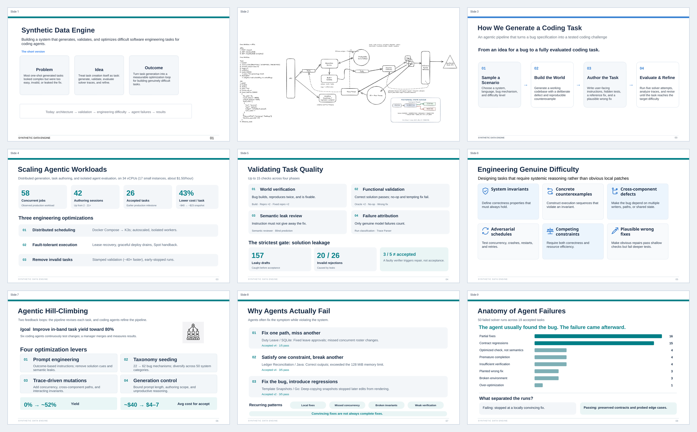

# synthetic-data-engine

A closed-loop synthetic data engine: agents build executable bug-worlds, author tasks from
them, a pinned solver calibrates their difficulty, and a durable job scheduler runs the whole
loop at scale.

The output is RL training environments in the Harbor / Terminal-Bench 2 task format. A task is
kept only when it's **learnable**: 1–3 of 5 agent runs pass with `terminus-2` +
`glm-5.3-flash` at `reasoning_effort=high`.



*The presentation in 9 slides* (the deck: [docs/slides/synthetic-data-engine-presentation-v5.pptx](docs/slides/synthetic-data-engine-presentation-v5.pptx)).

**All documentation is indexed in [Docs](#docs) at the end of this README.**

## How we got here

### 1. Targeted prompt and rule refinement, with a double feedback loop

At the start it was impossible to one-shot a task in the band: the first 16 tasks produced 0. So I
hill-climbed with two loops ([docs/HILLCLIMBING.md](docs/HILLCLIMBING.md)):

- **Loop 1, per task:** the pipeline revises its own tasks. A too-easy task gets a world mutation,
  a too-hard one an easier revision ([docs/EVALUATION.md](docs/EVALUATION.md)).
- **Loop 2, across tasks:** a sliding window with a draining window to test iterative refinements.
  Coding agents read the trajectories and proposed one subtle, targeted change per finding, each on
  its own branch per mini-batch "lane" ([38 lane branches](https://github.com/jamessmgao/synthetic-data-engine/branches/all?query=lane-)). I checked
  their changes, and each one was judged on the tasks authored after it
  ([docs/ITERATION_LOG.md](docs/ITERATION_LOG.md)).

Each lane worked in its own git worktree, on its own branch, so every targeted refinement can be
inspected on its own: `git fetch && git branch -r | grep lane-`, then `git log -p origin/<branch>`.

This was the inflection point for the yield rate. The prompts became good enough to one-shot a
significant share of tasks: 18 of the 43 accepted tasks were accepted at their first version.

The refinements themselves were small. Instructions became short user-voiced requests that don't
name the fix (342 → 92 words, [`b9e1d01`](https://github.com/jamessmgao/synthetic-data-engine/commit/b9e1d01)). When a guarantee had one textbook
remedy, the remedy went into the system already, subtly wrong ([`4916619`](https://github.com/jamessmgao/synthetic-data-engine/commit/4916619)).
Greedy-algorithm tasks, where "be optimal" names the fix, were replaced by subtle defects inside
exact algorithms ([`lane-l2-alg-exact`](https://github.com/jamessmgao/synthetic-data-engine/tree/lane-l2-alg-exact)). Mutations that add persistent
state became a last resort after 0 of 7 reached the band ([`9af8ab7`](https://github.com/jamessmgao/synthetic-data-engine/commit/9af8ab7)), and
tests started their own service on a free port ([`00f44fd`](https://github.com/jamessmgao/synthetic-data-engine/commit/00f44fd)).

### 2. The synthetic taxonomy

I started with distributed systems, the problems I knew. The worlds were small, with too few
components. To target harder problems I used an external model (ChatGPT) to seed ideas, so they
didn't all come from the model that authors the tasks, which avoids collapsing onto one model's
training distribution. The taxonomy grew from 22 to 62 bug mechanisms across six families and 40+
application domains ([`shared/taxonomy/taxonomy.py`](shared/taxonomy/taxonomy.py),
[docs/DIFFICULTY.md](docs/DIFFICULTY.md)). The synthetic taxonomy gave the diversity, and the
iterative mutations made the tasks novel.

**Result:** 0 of the first 16 tasks in band; about 58% of decided tasks now (43 accepted of 74, as
of 2026-11-19 06:45 UTC). Why the accepted tasks are hard:
[docs/AGENT_FAILURE_ANALYSIS.md](docs/AGENT_FAILURE_ANALYSIS.md). Example tasks with links to the runs:
[docs/DEMO_EXAMPLES.md](docs/DEMO_EXAMPLES.md).

## What it does

### 1. Builds worlds

A terminus-2 + glm-5.1 agent session (in the `sde-authoring` image) builds an executable
**world**: a small buggy system with invariants, a reproducible counterexample, a real fix and
a plausible wrong fix. A deterministic **world_check** proves it: the world builds, the repro
fails, the fix passes, the symptom is visible, the fix isn't local, and the wrong fix fools the
symptom (hardness checks set by `SDE_WORLD_HARDNESS`). A failing world goes to world-repair
(≤2). When a task is too easy, the **world** is mutated, not the wording. See
[docs/WORLD_CONSTRUCTION.md](docs/WORLD_CONSTRUCTION.md) and
[docs/AUTHORING.md](docs/AUTHORING.md).

### 2. Creates tasks

A second agent session writes a **task** from the world: the instruction, Dockerfile, tests
and reference solution. The validate gates check it: structural, lint, oracle ×2, nop,
wrong_fix, and a blind leak review. A failing task goes to repair (≤2). See
[docs/VALIDATION.md](docs/VALIDATION.md).

A one-shot mode (`SDE_AUTHOR_MODE=oneshot`, the default) drafts the whole bundle in one
strict-JSON glm-5.1 call instead. It's the baseline, and the fallback for raw prompts and v1
specs. The mode is chosen per job: a create or revise job with a `world_sha256` runs the agent
author (`shared/jobs/worker.py:draft_fn`).

### 3. Calibrates difficulty

The **Executor** runs 5 agent runs on the pinned solver (terminus-2 + glm-5.3-flash,
reasoning high). The **Trace Parser** decides whether each failure is the model's fault or the
task's; timeouts and infrastructure errors never count as model failures. Calibration then
routes the task:

- 1–3 of 5 valid passes, failures blamed on the model → **accepted** (published);
- too easy (4–5/5) → **world mutation** (v+1): 1–2 operators aimed at what passed;
- too hard (0/5) → **revise easier** on the same world;
- the task at fault → **repair**;
- at most 8 versions (`SDE_MAX_VERSIONS`), then rejected.

See [docs/EVALUATION.md](docs/EVALUATION.md).

### 4. Schedules jobs

Every arrow in the loop is a job on a durable, Postgres-backed scheduler:

- the `jobs` table is the queue, the outbox and the audit log; Redis sorted sets (one per job
  type) are only a dispatch index;
- workers are stateless; claims are leased and fenced by a token, with heartbeats that survive
  store errors (`shared/jobs/worker.py:run_one`, `evaluation/executor.py:Executor._heartbeat`);
- hand-offs commit the next job in the same transaction as the settle
  (`shared/jobs/handoffs.py:after_world`, `after_world_check`, `after_generation`, `after_validate`);
- a reconciler re-publishes lost queue entries and dead-letters jobs that keep failing (and
  rejects their task);
- Docker slots, agent slots, a memory guard and a CPU guard gate each claim
  (`shared/jobs/jobqueue.py:JobQueue.claim`).

Any service can be killed, restarted or run as several copies without losing or re-paying
work. The same code runs locally on Docker Compose (or a local k3d cluster) and in production
on AWS: K3s on EC2 instances with KEDA autoscaling the Executor, RDS Postgres, ElastiCache
Redis and S3. The backends come from the environment: SQLite or Postgres, the jobs table or
Redis, files or S3.

## The flow

```
POST /v1/tasks | /v1/batches
        │
        ▼  agent mode (spec v2: family, mechanism, shape, dial)
  world ──► world_check ──fail──► world-repair (≤2) ──► … ──► REJECTED invalid
  (agent)   (gate: build, repro fails, fix passes, symptom visible,
             fix not local, wrong fix fools the symptom; SDE_WORLD_HARDNESS)
        │ ok
        ▼
  create ──► validate ──fail──► repair (≤2, also when create's leak review fails)
  (agent from the world,  (structural · lint · oracle×2 · nop · wrong_fix · leak)
   or one-shot)
        │ ok
        ▼
  agent runs ×5 (terminus-2 + glm-5.3-flash, high) ──► analyze (Trace Parser)
        │
        ├─ 1–3 of 5 valid passes, failures blamed on the model ──► ACCEPTED (published)
        ├─ too easy (4–5/5) ──► world mutation (v+1): 1–2 operators aimed at what passed
        ├─ too hard (0/5)  ──► revise "easier" on the same world
        ├─ the task blamed ──► revise "repair_ambiguity"
        └─ out of band at MAX_VERSIONS (8) ──► REJECTED exhausted
```

The architecture diagram is [`docs/diagrams/synthetic-data-engine.excalidraw`](docs/diagrams/synthetic-data-engine.excalidraw);
the original design spec is [`docs/SPEC.md`](docs/SPEC.md).

## Services

| Service | Entry point | Consumes | Code |
|---|---|---|---|
| API | `python -m api` | HTTP | `api/app.py:create_app`, `api/submit.py:create_task` / `create_batch` |
| Generation Service | `python -m generator.service generation` | `world`, `create`, `revise` | `shared/jobs/worker.py:serve_generation`, `world_fn`, `draft_fn`; `generator/author.py:run_world_job`, `generator/author_task.py:run_create_job`, `generator/worker.py:run_generate_job` (one-shot) |
| Build + Validate | `python -m validator.service validate` | `validate`, `world_check` | `validator/gates.py:run_validate_job` (`gate_wrong_fix`, `gate_leak`), `shared/taskformat/world_check.py:run_world_check_job` |
| Executor | `python -m evaluation.executor` | `rollout` (agent runs) | `evaluation/executor.py:Executor`, `evaluation/harbor.py:run_trial`, `evaluation/classify.py` |
| Trace Parser | `python -m evaluation.trace_parser_service` | `analyze` | `evaluation/trace_parser_service.py:TraceParserService.analyze` / `next_job`, `evaluation/trace_parser.py:parse` / `review_passes`, `evaluation/calibration.py:choose_mutations` |
| Reconciler | `python -m shared.jobs.reconciler` | (timer) | `shared/jobs/reconciler.py:reconcile`: re-publishes lost queue entries, dead-letters poison jobs (and rejects their task), sweeps staging |

State: Postgres (`tasks` + `jobs`), Redis (one sorted set per job type), S3 (bundles, worlds,
drafts, traces). A spend cap can stop new paid claims (`shared/storage/budget.py:claim_filter`).

## Quick start

```bash
make deps-up              # Postgres + Redis + S3 only (for the tests)
make test-all             # every suite, incl. e2e on SQLite and the compose cluster (no model calls)
make authoring-image      # build sde-authoring:dev (agent mode)
cp deploy/local.env.example deploy/local.env   # then set what you need (below)
make up-agent             # the whole stack in agent mode (or `make up` for one-shot)
curl -s localhost:8000/healthz                 # status, DB, budget cap and spend
```

Runtime settings (`SDE_*`) are listed in [docs/DEPLOY.md](docs/DEPLOY.md), and `deploy/local.env.example` lists every setting the code reads. The stack reads the gateway key from the repo's `.env`, which is never committed.

### API

Every `/v1` call needs the header `X-Api-Key: <SDE_API_KEY>` (not Bearer). `GET /healthz` needs none.
Locally the API is `localhost:8000`; on AWS it's the tunnel URL that `make aws-k8s-public` prints.
Full request and response shapes are in [docs/API.md](docs/API.md); a Claude Code skill for driving
the API is at [`.claude/skills/sde-pipeline-api/SKILL.md`](.claude/skills/sde-pipeline-api/SKILL.md).

| Route | Does |
|---|---|
| `GET /v1/families` | what you can ask for: the families and each one's mechanisms and environments |
| `POST /v1/batches` | submit N tasks (1–50): `count`, `batch_id`, `area` (a family or a list), `mechanism`, `environment`, `dial` (1–3) |
| `POST /v1/tasks` | submit one task from a `prompt`, a `spec`, or nothing (sampled) |
| `GET /v1/batches/{id}` | follow a batch: each task's status, version, pass pattern and cost |
| `GET /v1/tasks/{id}` | one task in full: versions, gates, every agent run with the failure explanation |
| `POST /v1/batches/{id}/cancel`, `POST /v1/tasks/{id}/cancel` | stop a batch or a task |

Every other route (reports, the queue, the world pool, artifacts, health) is in [docs/API.md](docs/API.md).

```bash
H='X-Api-Key: <SDE_API_KEY>'
curl -s localhost:8000/v1/families -H "$H"
curl -s -X POST localhost:8000/v1/batches -H "$H" -H 'Content-Type: application/json' \
  -d '{"batch_id": "b1", "count": 5, "area": ["database_consistency", "compilers_parsers"], "dial": 3}'
curl -s localhost:8000/v1/batches/b1 -H "$H"          # per-task status, version, pass pattern, cost
curl -s localhost:8000/v1/tasks/b1-t01 -H "$H"         # one task in full
curl -s -X POST localhost:8000/v1/batches/b1/cancel -H "$H" -H 'Content-Type: application/json' -d '{"note": "stop"}'
```

`scripts/run_tasks.py --batch b1 --count 10` runs a whole batch: it creates the batch, follows it and writes `output/reports/<batch>/summary.json`. Accepted tasks are published to
`output/accepted/<task>/` with a `verdict.md` (`evaluation/verdict.py`).

### Deploy

- **Local:** `make test-infra` runs SQLite, Postgres, Postgres+Redis and S3. `make up` /
  `make up-agent` runs the whole stack in Docker Compose. `make k8s-test` runs the chaos test
  on a local k3d cluster.
- **AWS:** Terraform under `deploy/terraform` creates the EC2 instances, RDS Postgres,
  ElastiCache Redis, S3 and SSM-only access, operated with `deploy/aws_ops.py` / `make aws-*`.
  `make aws-k8s-up` installs K3s and KEDA across the EC2 instances; `make aws-k8s-deploy
  OVERLAY=aws-prod` applies the production overlay (`infra/k8s/overlays/aws-prod`). Agent
  mode: `make aws-author-mode MODE=agent`.

See [docs/DEPLOY.md](docs/DEPLOY.md) for deployment and every runtime setting,
[docs/DEPLOY.md](docs/DEPLOY.md) for agent mode,
[docs/CAPACITY.md](docs/CAPACITY.md) for the cluster's size, concurrency limits and cost, and
[docs/LOAD_TEST.md](docs/LOAD_TEST.md) for the load test with mocked models. CPU is the
bottleneck; there were 0 INVALID in 230 agent runs.

## Docs

**Start here**
- [docs/slides/](docs/slides/): the presentation (the 9-slide image above, and the deck).
- [docs/DEMO_EXAMPLES.md](docs/DEMO_EXAMPLES.md): seven example tasks for the demo, with links to the runs in the dashboard.
- [CHANGELOG.md](CHANGELOG.md): every change, with commits.

**Design**
- [docs/PRD.md](docs/PRD.md): requirements, data model, API, the services-on-queues design, deep dives.
- [docs/SPEC.md](docs/SPEC.md): the original implementation spec (historical; the PRD is current).
- [docs/DURABILITY.md](docs/DURABILITY.md): every durability and recovery guarantee, with its code, test and limits.
- [docs/WORKER_INTERFACE.md](docs/WORKER_INTERFACE.md): the job-function contract between the services and the task-building code.
- [docs/ARCHITECTURE_REVIEW.md](docs/ARCHITECTURE_REVIEW.md): every review finding, with its resolution and commit.
- [docs/diagrams/](docs/diagrams/): the architecture sketch and the Excalidraw diagrams.

**Generating tasks**
- [docs/AUTHORING.md](docs/AUTHORING.md): world-first agent authoring as built: job types, contracts, mutations, variants, reused worlds.
- [docs/WORLD_CONSTRUCTION.md](docs/WORLD_CONSTRUCTION.md): the method: worlds, invariants, counterexamples, mutation operators.
- [docs/DIFFICULTY.md](docs/DIFFICULTY.md): what makes a task hard, and the recipe for creating one.
- [docs/TASK_GENERATION_RULES.md](docs/TASK_GENERATION_RULES.md): what a good task is: the rules the authoring prompts enforce.
- [docs/TASK_CREATION_OPTIMIZATION.md](docs/TASK_CREATION_OPTIMIZATION.md): how we optimized task creation: levers, taxonomy, revisions, throughput, results.

**Validating and evaluating**
- [docs/VALIDATION.md](docs/VALIDATION.md): every gate that can stop a task (world_check, validate, the leak review), with counts and edge cases.
- [docs/EVALUATION.md](docs/EVALUATION.md): the Executor, the Trace Parser, the mutation rules, the verdict format.
- [docs/AGENT_FAILURE_ANALYSIS.md](docs/AGENT_FAILURE_ANALYSIS.md): every accepted task's agent runs read: why the tasks are hard and how agents fail.

**Tuning on the production cluster**
- [docs/HILLCLIMBING.md](docs/HILLCLIMBING.md): the goal, the sliding-window method, the lanes, the stopping rules and the limits.
- [docs/ITERATION_LOG.md](docs/ITERATION_LOG.md): every iteration and window: changes, per-task outcomes, yield.

**Running it**
- [docs/DEPLOY.md](docs/DEPLOY.md): deployment (Compose, k3d, K3s on AWS), agent mode, and every runtime setting.
- [docs/KUBERNETES.md](docs/KUBERNETES.md): the K3s / KEDA cluster as built.
- [docs/CAPACITY.md](docs/CAPACITY.md): concurrency limits, throughput, utilization and cost.
- [docs/LOAD_TEST.md](docs/LOAD_TEST.md): finding the bottleneck: mocked-model and real-load tests.
- [docs/API.md](docs/API.md): every route, with request and response shapes.
- [docs/TESTING.md](docs/TESTING.md): the test suites, the e2e harness and the agent-mode scenarios.
- [web/README.md](web/README.md): the dashboard (Overview, Batches, Tasks, Analytics).
- [docs/TODO.md](docs/TODO.md): deferred work.

**Archive** ([docs/archive/](docs/archive/)): early analyses kept for the record (`ANALYSIS.md`, `PILOT_RESULTS.md`, `LINKS.md`).
